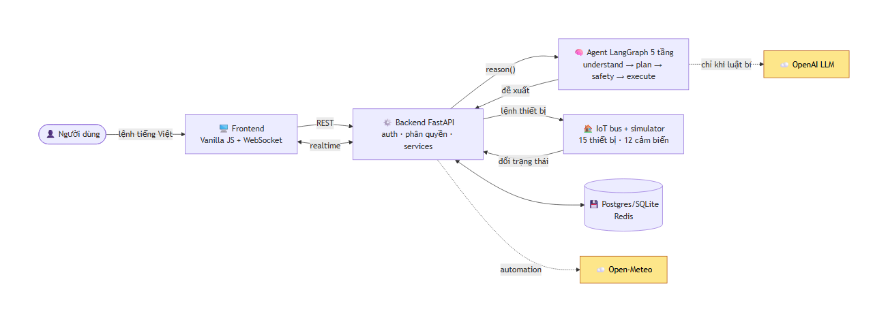

# 🏠 VinButler — Trợ lý nhà thông minh tiếng Việt

Agent hiểu lệnh tiếng Việt, điều khiển thiết bị trong nhà, hỏi lại khi lệnh chưa rõ, và yêu cầu chủ hộ duyệt khi thành viên dùng thiết bị được cấp quyền `request`.

> 📖 [Kiến trúc hệ thống](docs/architecture.md)

## Tính năng

| Tính năng | Ghi chú |
|---|---|
| Đăng nhập, hai vai trò: chủ hộ và thành viên | Chủ hộ dùng mọi thiết bị; thành viên chỉ dùng thiết bị được cấp quyền |
| Quyền theo từng thiết bị | `accepted`: dùng ngay · `alert`: dùng và báo chủ hộ · `request`: chờ chủ hộ duyệt · chưa cấp: không dùng được |
| Lệnh tiếng Việt có dấu hoặc không dấu | Lệnh một thiết bị chạy được cả khi offline |
| Hỏi lại khi thiếu thông tin | `tắt đèn` → hỏi phòng → trả lời `phòng khách` để tiếp tục |
| Duyệt lệnh (human-in-the-loop) | Lệnh của thành viên có quyền `request` nằm chờ chủ hộ duyệt |
| Lịch sử hành động | `GET /api/v1/history` |
| Dữ liệu mẫu | 30 thiết bị và 13 cảm biến trên dashboard của chủ hộ |
| Chạy offline (mặc định) | `LLM_DISABLED=true` trong `.env.example`: chỉ dùng luật tiếng Việt, không gọi mạng |
| Tự động hoá theo thời tiết và AQI | Lấy dữ liệu từ Open-Meteo, cần mạng |
| Mã hoá dữ liệu cá nhân | Khoá riêng cho từng hộ (`src/core/security.py`) |

**Chưa kiểm chứng trong bản này:** kế hoạch nhiều thiết bị cho một lệnh (cần LLM hợp lệ), cảnh báo xung đột sở thích, học thói quen, MQTT và Postgres.

## Công nghệ

| Thành phần | Công nghệ |
|---|---|
| Điều phối agent | LangGraph |
| Backend | FastAPI, Pydantic, SQLAlchemy |
| LLM (tùy chọn) | OpenAI, Ollama hoặc Gemini, chọn bằng `LLM_PROVIDER` |
| Cơ sở dữ liệu | SQLite mặc định; Postgres qua `DATABASE_URL` |
| IoT | Bus trong bộ nhớ mặc định; MQTT (Mosquitto) tùy chọn |
| Frontend | HTML, CSS, JavaScript thuần; WebSocket cập nhật realtime; mô hình 3D bằng three.js |

## Kiến trúc



Chi tiết pipeline 5 tầng, luồng HITL và ánh xạ thành phần → mã nguồn: **[docs/architecture.md](docs/architecture.md)**.

Cấu trúc thư mục:

```
src/        backend: agent, api, services, iot, db, domain, core, nlu, planning, memory
frontend/   giao diện web (HTML/CSS/JS), mô hình 3D và icon
tests/      bộ test pytest
docs/       kiến trúc và sơ đồ
config/     cấu hình năng lượng (energy.yaml)
```

## Yêu cầu

- Python 3.11 (đã kiểm tra với 3.11.15)
- Không cần Docker, Postgres, Redis hay Mosquitto
- `make` là tùy chọn (macOS/Linux)

## Cài đặt và chạy

Chạy các lệnh sau trong thư mục gốc của dự án:

```bash
python3.11 -m venv .venv
source .venv/bin/activate
pip install -r requirements.txt
cp .env.example .env
```

Mở `.env` và chọn một trong hai chế độ. `.env.example` đặt sẵn chế độ offline:

- **Offline (mặc định):** giữ `LLM_DISABLED=true`. Agent chỉ dùng luật tiếng Việt, không cần khóa và không gọi mạng.
- **Có LLM:** đặt `LLM_DISABLED=false`, điền `OPENAI_API_KEY` bằng khóa thật và `MODEL_NAME` bằng tên model bạn được dùng. Với khóa giả hoặc để trống, lệnh nhiều ý sẽ không chạy, và log ghi lỗi `AuthenticationError`. Lệnh một thiết bị vẫn chạy nhờ luật.

Chạy server:

```bash
uvicorn src.main:app --reload --port 8000
```

Hoặc dùng `make run` (cần `.venv` đã tạo ở bước trên).

Sau khi chạy:

- Giao diện: http://localhost:8000 (chuyển sang trang đăng nhập nếu chưa đăng nhập)
- API docs: http://localhost:8000/docs (mọi API nằm dưới `/api/v1`)

Lần chạy đầu tự tạo `data/app.db` và dữ liệu mẫu. Để làm lại từ đầu: dừng server, xóa thư mục `data/`, rồi chạy lại.

Không commit file `.env`: file này chứa khóa và bí mật.

### Tài khoản demo

Mật khẩu chung: `demo1234`

| Tài khoản | Họ tên | Vai trò | Ghi chú |
|---|---|---|---|
| `bo` | Trần Văn Bố | Chủ hộ | Dùng mọi thiết bị |
| `me` | Nguyễn Thị Mẹ | Chủ hộ | Dùng mọi thiết bị |
| `con_lon` | Trần Minh Anh | Thành viên | Chỉ dùng thiết bị được chủ hộ cấp quyền |
| `con_nho` | Trần Bảo Bảo | Thành viên | Chỉ dùng thiết bị được chủ hộ cấp quyền |

## Kịch bản thử

Đã chạy kiểm chứng ở chế độ offline (`LLM_DISABLED=true`):

1. Đăng nhập `bo` → dashboard có 30 thiết bị và 13 cảm biến.
2. `tắt đèn` → agent hỏi: *"Bạn muốn mình làm ở Phòng khách, Phòng bếp, Phòng ngủ bố mẹ, hay Phòng ngủ con ạ?"* → trả lời `phòng khách` → agent xử lý lệnh tắt Đèn chùm (nếu đèn đang bật thì tắt; nếu đã tắt thì báo giữ nguyên).
3. `bat den phong khach` (không dấu) → *"Đã bật Đèn chùm."*
4. Đăng nhập `con_nho` → `bật bình nóng lạnh` → bị từ chối: *"Bạn chưa được chủ hộ cấp quyền dùng Bình nóng lạnh."*
5. Đăng nhập `bo` → `bật bình nóng lạnh` → bật ngay, chủ hộ không cần duyệt.
6. Luồng duyệt:
   - Chủ hộ đặt quyền `request` cho `con_lon` với thiết bị `binh_nong_lanh`:
     `PUT /api/v1/members/{id}/access` với body `{"rules": [{"device_slug": "binh_nong_lanh", "effect": "request"}]}`.
     Id của `con_lon` là `3` trong dữ liệu mẫu.
   - `con_lon` gửi `bật bình nóng lạnh` → lệnh chờ duyệt.
   - Chủ hộ duyệt bằng `POST /api/v1/agent/approvals/{id}` với body `{"approved": true}` → thiết bị bật.

## Hạn chế đã biết

- Kế hoạch nhiều thiết bị cho lệnh như *"tối nay có khách, chuẩn bị phòng khách"* cần LLM hợp lệ. Ở chế độ offline, lệnh này chỉ bật Đèn chùm 100%.
- Cảnh báo xung đột sở thích (ví dụ bố 26°C, mẹ 24°C) chưa xuất hiện trong các kịch bản đã thử.
- Khi bật LLM (`LLM_DISABLED=false`) mà khóa OpenAI là giả hoặc để trống, mỗi lệnh gọi LLM ghi lỗi `AuthenticationError` vào log, và lệnh nhiều ý không được xử lý.
- Tự động hoá theo thời tiết cần Internet để gọi Open-Meteo.
- MQTT và Postgres chưa được chạy trong bản kiểm tra này.

## Kiểm thử

```bash
make test        # pytest tests/ -v, chạy offline
make lint        # ruff check src/ tests/
make typecheck   # mypy src/
```

Không có `make`, chạy trực tiếp: `APP_ENV=test LLM_DISABLED=true pytest tests/ -v`.

Test chạy offline, mỗi test có database riêng.

## Cấu hình

Xem [.env.example](.env.example). Các biến đáng chú ý:

| Biến | Mặc định | Tác dụng |
|---|---|---|
| `LLM_DISABLED` | `true` trong `.env.example` | `true` = chỉ dùng luật tiếng Việt, không gọi mạng. `false` = bật LLM, cần khóa hợp lệ. Nếu không có `.env`, mã mặc định là `false` nhưng không có khóa thì vẫn không gọi LLM |
| `LLM_PROVIDER` | `openai` | `openai`, `ollama` hoặc `gemini` |
| `OPENAI_API_KEY`, `MODEL_NAME` | placeholder, trống | Cần khi dùng LLM |
| `DATABASE_URL` | `sqlite:///./data/app.db` | Đổi sang `postgresql+psycopg://…` để dùng Postgres |
| `MQTT_ENABLED` | `false` | `true` = nối Mosquitto thay vì bus trong bộ nhớ |
| `PM25_THRESHOLD` | `55` | Ngưỡng bụi để agent đề xuất đóng cửa sổ |
| `AWAY_MINUTES_THRESHOLD` | `120` | Vắng nhà bao lâu thì cảnh báo lãng phí điện |
| `ENVIRONMENT_REALTIME_ENABLED` | `true` | Lấy thời tiết và AQI từ Open-Meteo (cần mạng) |
| `ENVIRONMENT_AUTO_EXECUTE` | `true` | Tự thực hiện hành động môi trường trong allowlist rủi ro thấp |
| `ENVIRONMENT_LATITUDE`, `ENVIRONMENT_LONGITUDE` | `10.7769`, `106.7009` (TP.HCM) | Tọa độ nhà dùng để lấy dữ liệu |
| `DEMO_CLOCK_ENABLED` | `false` | Chỉ bật tạm khi cần đổi thời gian |
| `DEMO_SENSOR_CONTROLS_ENABLED` | `false` | Chỉ bật tạm khi cần nhập cảm biến giả |

Dữ liệu môi trường được làm mới mỗi 5 phút (`ENVIRONMENT_REFRESH_SECONDS=300`). Chỉ các hành động rủi ro thấp trong allowlist được tự thực hiện. Thói quen và chế độ vắng nhà chỉ là đề xuất, cần người dùng chấp nhận.
